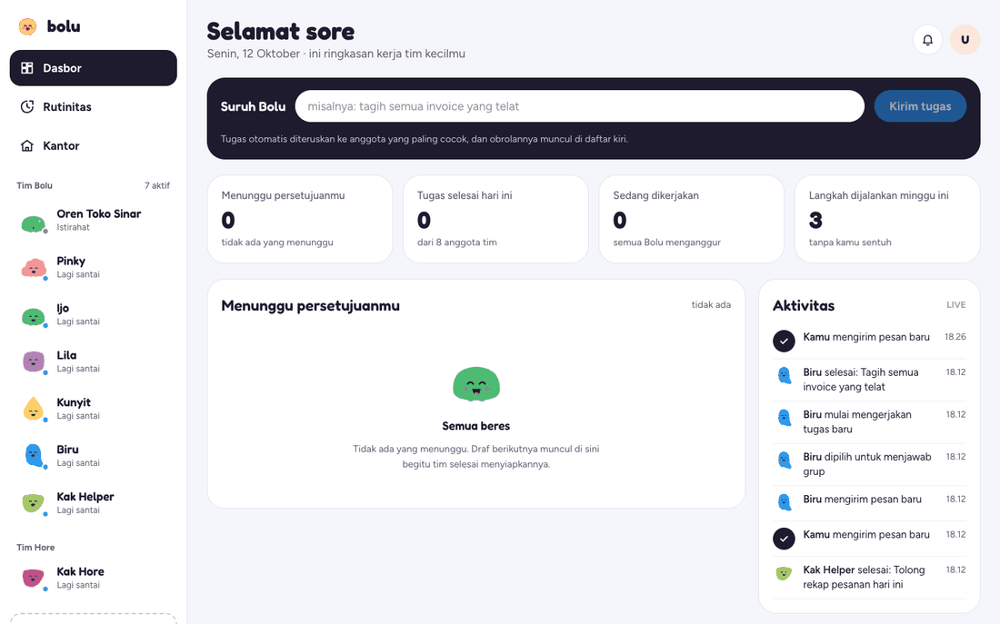
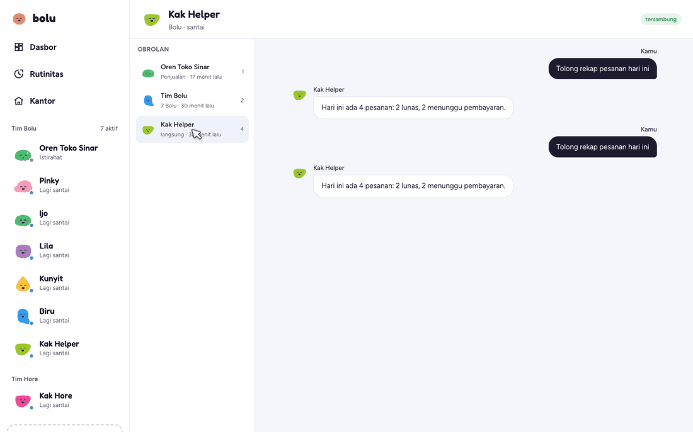
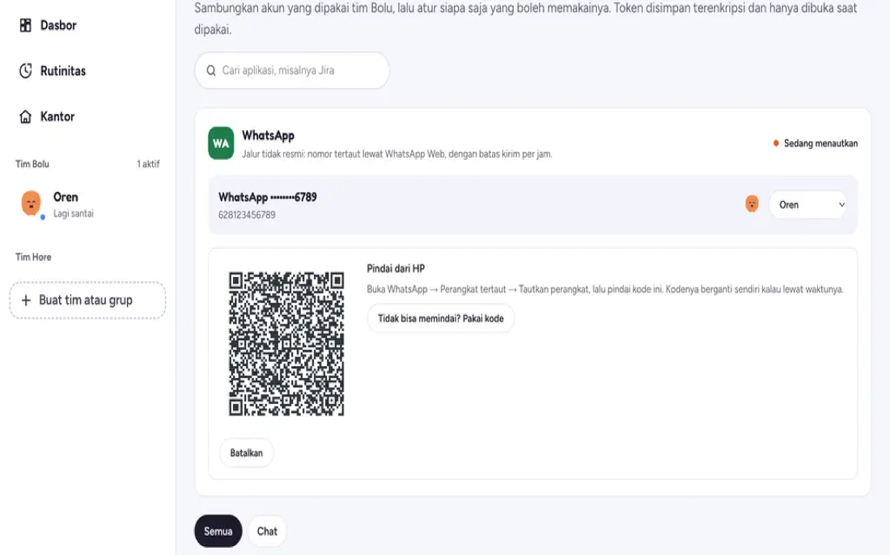
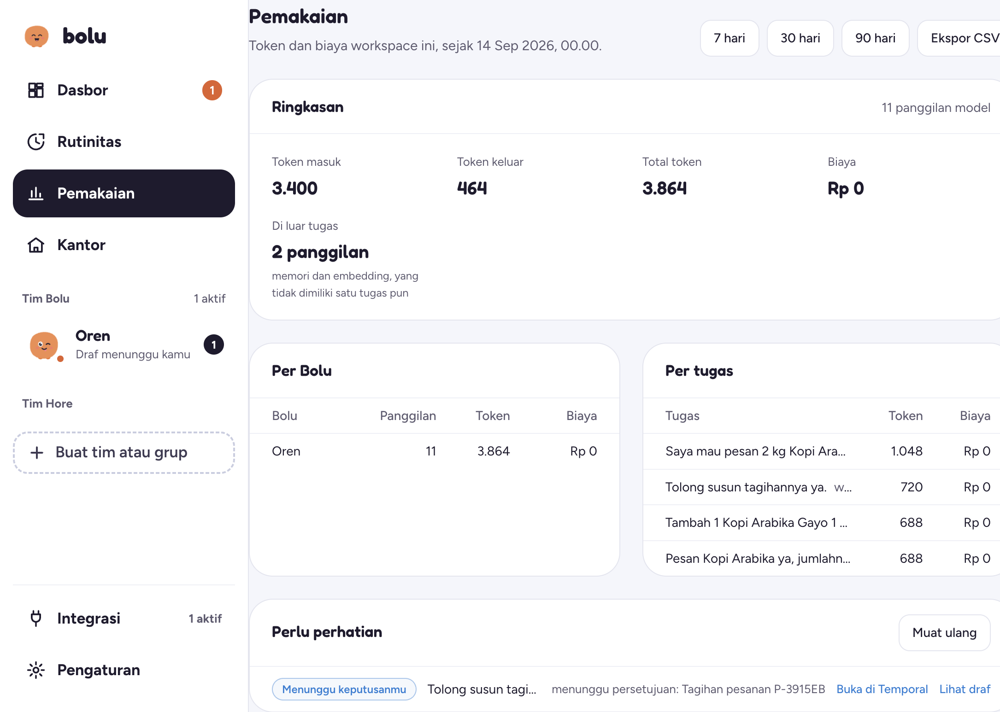
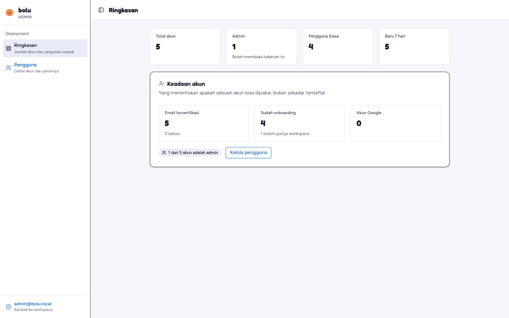
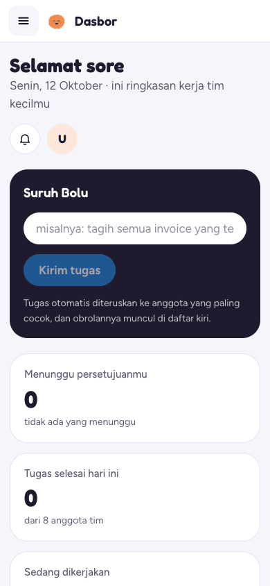

# Bolu

**AI teammates for everyday business work.** Each Bolu has a role, a persistent workspace, and access to the tools it needs. People stay in control of work that reaches customers: outbound actions can be reviewed and approved before they are sent.

> Bolu is under active development. The local demo provides a ready-to-use workspace backed by scripted responses; production use requires configuring your own model provider and deployment services.

## Product preview

The screenshots below show the workspace and operator console. More screens and capture notes are available in the [dashboard gallery](docs/dashboard/README.md) and [admin gallery](docs/admin/README.md).

| Workspace dashboard | Chat | Integrations |
| --- | --- | --- |
|  |  |  |

| Usage | Admin overview | Mobile workspace |
| --- | --- | --- |
|  |  |  |

## What it includes

- **Workspace and team management:** organize companies, members, Bolu teammates, and groups.
- **Task-oriented work:** chat, routines, task history, and hand-offs provide visibility into ongoing work.
- **Human review:** drafts, approval policies, and an audit trail help govern outbound actions.
- **Connected tools:** integrations include Gmail and WhatsApp, with access grants managed per Bolu.
- **Memory and usage:** workspace knowledge, per-Bolu memory, and model usage reporting.
- **Operator console:** platform-level account administration under `/admin`.

## Architecture

Production runs a Bun/TypeScript backend and a Next.js frontend; the original Go backend is kept as the reference and is not deployed ([#422](https://github.com/anakbolu/timbolu/issues/422)). The backend owns product APIs and durable agent work; the separate WhatsApp gateway owns WhatsApp sessions and media. Shared contracts and platform libraries live in `packages/`.

```text
apps/
  backend-js/    Bun API and Temporal workers (what production runs)
  backend/       Go API and Temporal workers — reference only, not deployed (#422)
  whatsapp-gw/   WhatsApp connection gateway
  frontend/      Next.js web application
  virtual-computer/  Virtual-computer proof of concept
packages/        Shared Go libraries and service contracts
docs/            Architecture, deployment, product flows, and screenshots
```

`apps/virtual-computer/` is a proof of concept that is being retired (#402). The runtime
direction is Daytona — see [ADR 0004](docs/adr/0004-daytona.md) and #397.

| Component | Main technologies |
| --- | --- |
| Backend | Bun + TypeScript in production (`apps/backend-js`); Go reference tree in `apps/backend` (#422); PostgreSQL + pgvector, Redis, Temporal |
| WhatsApp gateway | Go, whatsmeow, Redis, PostgreSQL, object storage |
| Frontend | Next.js App Router, TypeScript, Tailwind CSS v4 |
| Local infrastructure | Docker Compose |

## Quick start

Requirements: Docker with Compose, Git, and Make.

```bash
git clone <repository-url>
cd timbolu
cp .env.example .env
make up
```

The stack builds and starts PostgreSQL, Redis, Temporal, database migrations, the API, workers, WhatsApp gateway, and frontend.

| Service | Local URL |
| --- | --- |
| Web application | http://localhost:3000 |
| API health | http://localhost:8080/health |
| API readiness | http://localhost:8080/ready |
| WhatsApp gateway health | http://localhost:8090/health |
| Temporal UI | http://localhost:8233 |

### Clickable demo

For a seeded local workspace and scripted model/mailbox providers, run:

```bash
make demo
```

Sign in with `demo@bolu.local` / `Rahasia123!`. The demo script prints suggested flows. Responses come from a scripted stub, so this is useful for exploring product flows, not evaluating model quality. Stop the demo services with `make demo-stop`.

To use a real model, configure the appropriate `LLM_DEFAULT_*` values in `.env` and start the regular stack with `make up`.

## Development

Run a single process locally when the required services and environment variables are available:

```bash
make frontend
make backend
make wa-gateway
```

Install frontend dependencies from its own directory; this repository has no root `package.json`:

```bash
cd apps/frontend
npm ci
npm run dev
npm run lint
npm run build
```

Useful Make targets:

| Target | Purpose |
| --- | --- |
| `make up` / `make down` / `make logs` | Start, stop, or inspect the local stack |
| `make test` | Run Go test suites across shared packages and services |
| `make cover` | Run Go coverage gates |
| `make lint` / `make archcheck` | Run Go linting and backend dependency checks |
| `make smoke-task` / `make smoke-approval` / `make smoke-order` | Exercise product flows against a running stack |
| `make help` | List available targets |

## Documentation

- [Deployment guide](docs/deployment.md)
- [Deep link contract](docs/deep-links.md)
- [SEO](docs/seo.md)
- [End-to-end MVP flow](docs/e2e-mvp.md)
- [Data policy](docs/kebijakan-data.md)
- [Architecture decision records](docs/adr/)
- [Frontend documentation](apps/frontend/README.md)
- [Backend documentation](apps/backend-js/README.md)
- [WhatsApp gateway documentation](apps/whatsapp-gw/README.md)
- [Dashboard screenshots and capture notes](docs/dashboard/README.md)
- [Admin screenshots and capture notes](docs/admin/README.md)

## Project status

Bolu is actively developed. Current product routes and capabilities evolve with the codebase; consult the component READMEs and deployment guide for implementation details. The MVP order flow and its measurement approach are documented in [docs/e2e-mvp.md](docs/e2e-mvp.md).

## License

No license file is currently included. Contact the maintainers before redistributing this project.
