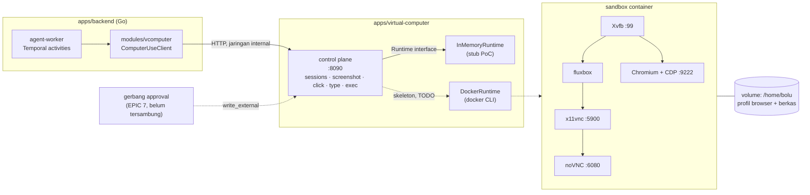

# Virtual Computer — PoC

Satu komputer per bot: layar desktop, browser, dan terminal di dalam satu container,
dikendalikan satu control plane kecil yang dipanggil worker Temporal.

**Ini PoC, bukan produksi.** Keputusannya ada di
[`docs/adr/0003-virtual-computer.md`](../../docs/adr/0003-virtual-computer.md); riset
lengkapnya di [`docs/riset-microvm.md`](../../docs/riset-microvm.md). Yang belum
dibangun dan sengaja tidak diklaim: isolasi untuk kode tak tepercaya (ini container
biasa), reaper idle, snapshot, lease layar, dan gerbang persetujuan untuk aksi keluar.

## Arsitektur



Empat hal yang dibaca dari diagram itu:

1. **Backend tidak memanggil Docker.** Ia memanggil satu API HTTP di jaringan internal.
   Control plane boleh berganti cara ia membuat sandbox (Docker hari ini, gVisor/K8s
   kelak) tanpa worker berubah.
2. **Sandbox adalah proses yang bisa dibaca daftarnya**, bukan satu "komputer" opaque:
   Xvfb → fluxbox → x11vnc → noVNC, plus Chromium dengan CDP.
3. **State yang bertahan ada di volume**, bukan di proses: profil browser dan berkas
   hidup di `/home/bolu`, jadi container boleh mati dan sesi tidak hilang. Workflow
   hanya membawa pengenal — aturan *claim check* di ADR 0001.
4. **Gerbang approval belum tersambung** (garis putus-putus). `click`, `type`, dan
   `exec` adalah `write_external` menurut riset §5.1; PoC men-stub jalur itu dan
   menyatakannya, bukan menganggapnya selesai.

## Isi direktori

| Path | Apa itu |
| --- | --- |
| `control/` | Control plane (modul Go sendiri, tanpa dependensi selain stdlib) |
| `control/internal/sandbox/` | Port `Runtime` + `InMemoryRuntime` (stub) + `DockerRuntime` (kerangka) |
| `control/internal/httpapi/` | Permukaan HTTP + uji end-to-end-nya |
| `sandbox/` | Image sandbox: `Dockerfile` + `entrypoint.sh` |
| `demo/index.html` | Halaman status statis untuk bukti visual |
| `docker-compose.poc.yml` | Stack PoC: control plane + satu sandbox contoh |

## Permukaan API

| Method | Path | Body | Jawaban |
| --- | --- | --- | --- |
| `GET` | `/health` | — | `{"status":"ok","service":"vcomputer-control","poc":true}` |
| `POST` | `/v1/sessions` | `{"bot_id":"..."}` | `Session` (idempoten) |
| `GET` | `/v1/sessions/:bot_id` | — | `Session`, `404` bila belum ada |
| `DELETE` | `/v1/sessions/:bot_id` | — | `{"stopped":true}` |
| `POST` | `/v1/sessions/:bot_id/screenshot` | — | `image/png` (juga `GET`, untuk ``) |
| `POST` | `/v1/sessions/:bot_id/click` | `{"x":0,"y":0}` | `{"clicked":true}` |
| `POST` | `/v1/sessions/:bot_id/type` | `{"text":"..."}` | `{"typed":true}` |
| `POST` | `/v1/sessions/:bot_id/exec` | `{"command":"..."}` | `ExecResult` — stub, perintah **tidak** dijalankan |

Status yang membawa arti: `400` input ditolak, `404` sesi tidak ada, `501` runtime
yang dipakai masih kerangka, `500` runtime gagal.

## Menjalankan

```bash
# Control plane saja, runtime stub, tanpa Docker sama sekali.
cd apps/virtual-computer/control && go run . -addr :8090

# Uji permukaan HTTP-nya.
cd apps/virtual-computer/control && go test ./...

# Seluruh stack PoC: control plane + satu sandbox contoh (butuh Docker).
docker compose -f apps/virtual-computer/docker-compose.poc.yml up --build
# Desktop contoh: http://localhost:6080/vnc.html
```

Lalu buka `apps/virtual-computer/demo/index.html` (file statis, tanpa build step) dan
tekan **Cek API** lalu **Buat sesi demo**; tangkapan layar stub akan muncul di sana.

Env yang dibaca: `VCOMPUTER_CONTROL_ADDR` (`:8090`), `VCOMPUTER_RUNTIME`
(`memory`|`docker`), `SCREEN_GEOMETRY` (`1280x800x24`), `VNC_PASSWORD` (kosong = tanpa
password, hanya boleh karena noVNC di-bind ke `127.0.0.1`).

## Bagaimana activity Temporal akan memanggilnya

Sudah ada, belum didaftarkan. `apps/backend/internal/modules/vcomputer/` berisi port,
klien HTTP, dan activity-nya; tidak satu pun dipanggil dari `internal/container`, jadi
`api` dan `agent-worker` berperilaku persis seperti sebelumnya.

```go
// internal/container/worker.go — dua baris ini yang menyambungkannya, dan sengaja
// belum ditulis: worker yang mendaftarkan activity tanpa control plane akan
// menggagalkan tugas yang tadinya jalan.
computer := vcomputerservice.New(c.Config.VComputer.ControlURL, 30*time.Second)
w.RegisterActivity(vcomputertemporal.New(vcomputertemporal.Deps{Computer: computer, Logger: c.Logger}))
```
Satu catatan yang belum diselesaikan: hasil `Screenshot` membawa byte PNG lewat
workflow, dan batas payload Temporal secara bawaan 2 MiB. Versi yang disambungkan
seharusnya menulis PNG ke object storage Jakarta dan mengembalikan kuncinya — aturan
*claim check* yang sudah berlaku untuk hal lain (ADR 0001).

## Yang di-stub, dan apa artinya

| Bagian | Keadaan PoC | Yang dibutuhkan untuk produksi |
| --- | --- | --- |
| `DockerRuntime` | Kerangka: setiap method mengembalikan `ErrNotImplemented` **beserta perintah yang akan dijalankannya** di dalam komentar | Klien Docker API di node sandbox, tanpa `docker.sock` di dalam sandbox |
| `exec` | Echo; perintah tidak pernah dijalankan di host maupun di sandbox | Label `write_external` + gerbang approval, atau allowlist perintah `read`-only |
| Gerbang approval | Tidak tersambung | Draf untuk `click`/`type`/`exec`, dengan tangkapan layar sebagai konteks |
| Autentikasi control plane | Tidak ada (hanya jaringan internal + bind `127.0.0.1`) | Seam internal berbagi rahasia, seperti gateway WhatsApp |
| Isolasi | Container runc yang dikeraskan (`cap_drop: ALL`, `no-new-privileges`, limit RAM/PID) | gVisor di Kubernetes (riset Fase 2) |
| Biaya saat idle | Tidak ada reaper | Idle timeout + snapshot, kuota per paket |
| Lease layar | Tidak ada (satu sandbox per bot, jadi belum perlu) | Lease Redis bila kelak satu sandbox per workspace |

## Bukti

- `go test ./...` di `control/` menutup siklus sesi, PNG yang benar-benar bisa didekode,
  tiga aksi, dan pemetaan status ke error.
- `go test ./internal/modules/vcomputer/...` di backend menutup kontrak klien terhadap
  control plane (body yang dikirim, PNG yang lewat utuh, sentinel error).
- `docs/poc-evidence/virtual-computer/` menyimpan tangkapan layar sebelum/sesudah.

Perintah yang menjalankannya, dan alasannya bukan bagian dari `make test`/`make lint`:
kedua target itu per modul produk, masing-masing dengan `.golangci.yml` dan
`scripts/coverage.sh` sendiri. Modul PoC ini belum punya keduanya, dan menaruhnya di
`make test` tanpa `make cover` akan setengah menyambung gerbang mutu — jadi ia tetap
modul terpisah dengan perintahnya sendiri sampai PoC ini lulus Gerbang 1.
