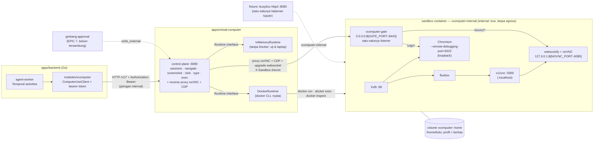

# Virtual Computer — PoC

Satu komputer per bot: layar desktop, browser, dan terminal di dalam satu container,
dikendalikan satu control plane kecil yang dipanggil worker Temporal.

**Ini PoC, bukan produksi.** Keputusannya ada di
[`docs/adr/0003-virtual-computer.md`](../../docs/adr/0003-virtual-computer.md); riset
lengkapnya di [`docs/riset-microvm.md`](../../docs/riset-microvm.md). Yang belum
dibangun dan sengaja tidak diklaim: isolasi untuk kode tak tepercaya (ini container
biasa), reaper idle, snapshot, lease layar, dan gerbang persetujuan untuk aksi keluar.

## Arsitektur



Enam hal yang dibaca dari diagram itu:

1. **Backend tidak memanggil Docker.** Ia memanggil satu API HTTP di jaringan internal,
   dengan `Authorization: Bearer`. Control plane boleh berganti cara ia membuat sandbox
   (Docker hari ini, gVisor/K8s kelak) tanpa worker berubah.
2. **Sandbox adalah proses yang bisa dibaca daftarnya**, bukan satu "komputer" opaque:
   Xvfb → fluxbox → x11vnc → websockify/noVNC, Chromium dengan CDP, dan satu gerbang
   (`vcomputer-gate`) yang mengekspos dua yang terakhir.
3. **State yang bertahan ada di volume**, bukan di proses: profil browser dan berkas
   hidup di `/home/bolu`, jadi container boleh mati dan sesi tidak hilang. Workflow
   hanya membawa pengenal — aturan *claim check* di ADR 0001.
4. **Sandbox hanya punya satu listener di alamat jaringannya: `vcomputer-gate`.**
   Xvfb dan fluxbox tidak membuka port sama sekali; x11vnc (`-localhost`),
   websockify/noVNC (`127.0.0.1:${NOVNC_PORT:-6080}`), dan Chromium
   (`--remote-debugging-port=9222`) mengikat loopback. Yang mendengarkan di
   `0.0.0.0:${GATE_PORT:-8443}` hanya gate: `/cdp/*` diteruskan ke `127.0.0.1:9222`,
   `/novnc/*` ke `127.0.0.1:${NOVNC_PORT}`, Host header ditulis ulang menjadi `localhost`
   (endpoint DevTools menolak nilai lain dengan 500), upgrade websocket diteruskan, dan
   setiap rute kecuali `/healthz` menuntut header `X-Sandbox-Secret`.

   Yang melindungi port itu adalah gate, **bukan** topologi jaringannya: host tetap
   bisa menyapa IP container di jaringan bridge buatan Docker — `internal: true`
   memblokir egress dari dalam container, bukan host → container.
5. **noVNC dan CDP di-proxy.** Browser (dan worker) hanya perlu menjangkau control
   plane: `/v1/sessions/<bot>/novnc/...` dan `/v1/sessions/<bot>/cdp/...` diteruskan ke
   gate di alamat container berikut upgrade websocket-nya dan header
   `X-Sandbox-Secret`. Tidak ada port sandbox yang pernah dipublikasikan ke host.
6. **Gerbang approval belum tersambung** (garis putus-putus). `click`, `type`, dan
   `exec` adalah `write_external` menurut riset §5.1; PoC men-stub jalur itu dan
   menyatakannya, bukan menganggapnya selesai.

## Isi direktori

| Path | Apa itu |
| --- | --- |
| `control/` | Control plane (modul Go sendiri, tanpa dependensi selain stdlib) |
| `control/internal/sandbox/` | Port `Runtime` + `InMemoryRuntime` (tanpa Docker) + `DockerRuntime` (nyata, lewat CLI docker) |
| `control/internal/httpapi/` | Permukaan HTTP, autentikasi token, proxy noVNC + CDP ke gate sandbox, plus ujinya |
| `sandbox/` | Image sandbox: `Dockerfile` + `entrypoint.sh` |
| `sandbox/gate/` | `vcomputer-gate`: modul Go sendiri (hanya stdlib), dibangun di satu stage image dan jadi satu-satunya listener di alamat jaringan sandbox |
| `fixture/` | Satu halaman statis yang disajikan `vcomputer-fixture` di jaringan internal |
| `demo/index.html` | Halaman statis yang menyematkan noVNC asli lewat proxy control plane |
| `docker-compose.poc.yml` | Stack PoC: `control` + `fixture` + target build `vcomputer-sandbox`, dan dua jaringan |
| `scripts/e2e.sh` | Checklist QA end-to-end: build, jalankan, periksa, tulis bukti, cetak PASS/FAIL. `STACK` dan `VCOMPUTER_CONTROL_PORT` wajib diisi — skrip berhenti sebelum menyentuh apa pun bila salah satunya kosong — dan pemeriksaan terakhirnya membuktikan `TEARDOWN=1` tidak meninggalkan container, volume, maupun jaringan bernama `${STACK}-*` |
| `scripts/cleanup.sh` | Versi CLI dari `POST /v1/admin/cleanup`: buang container berlabel `vcomputer.bot` yang tidak jalan (`VOLUMES=1` juga membuang volumenya, `--running` ikut membuang yang sedang jalan) |

## Permukaan API

| Method | Path | Body | Jawaban |
| --- | --- | --- | --- |
| `GET` | `/health` | — | `{"status":"ok","service":"vcomputer-control","poc":true}` — satu-satunya rute tanpa token |
| `POST` | `/v1/sessions` | `{"bot_id":"..."}` | `Session` (idempoten) |
| `GET` | `/v1/sessions/:bot_id` | — | `Session`, `404` bila belum ada |
| `DELETE` | `/v1/sessions/:bot_id` | — | `{"stopped":true}` — container dihentikan, volume rumahnya tetap |
| `DELETE` | `/v1/sessions/:bot_id?purge=true` | — | `{"stopped":true,"purged":true}` — container **dan** volume rumahnya dihapus |
| `POST` | `/v1/sessions/:bot_id/screenshot` | — | `image/png` (juga `GET`, untuk ``) |
| `POST` | `/v1/sessions/:bot_id/click` | `{"x":0,"y":0}` | `{"clicked":true}` |
| `POST` | `/v1/sessions/:bot_id/type` | `{"text":"..."}` | `{"typed":true}` |
| `POST` | `/v1/sessions/:bot_id/navigate` | `{"url":"http://..."}` | `200 {"navigated":true,"final_url":...,"title":...,"http_status":...}` setelah load-nya terbukti selesai dan dokumen utamanya menjawab < 400; `400` bila skemanya bukan `http`, `https`, `data`, atau `about`; `502 {"error":"navigation failed","url":...,"final_url":...,"http_status":...}` bila halaman berakhir di `chrome-error://`, tidak selesai dimuat dalam `VCOMPUTER_NAVIGATE_TIMEOUT`, **atau** dokumen utamanya menjawab 4xx/5xx |
| `POST` | `/v1/sessions/:bot_id/exec` | `{"command":"..."}` | `ExecResult` — perintahnya benar-benar dijalankan (`stub:false`) di runtime docker |
| `GET` | `/v1/sessions/:bot_id/novnc/...` | — | `httputil.ReverseProxy` ke gate sandbox (`/novnc/`), Host ditulis ulang jadi `localhost`, header `X-Sandbox-Secret` dipasang; upgrade websocket didukung |
| `GET`/`POST`/`PUT`/... | `/v1/sessions/:bot_id/cdp[/...]` | — | `httputil.ReverseProxy` ke gate sandbox (`/cdp/`), sama seperti noVNC — HTTP maupun websocket; `webSocketDebuggerUrl` di jawaban `/json/list` ditulis ulang ke prefix rute ini. Method **tidak** disaring — apa pun yang datang diteruskan apa adanya dan gate yang memutuskan — karena DevTools HTTP API bukan API seragam-method: `/json/list` dan `/json/version` `GET`, `/json/new` `PUT`, `/json/close` `GET`, dan rute yang menyebut method akan menjawab `405` untuk permintaan yang sah. Rute kosong `/cdp` juga dilayani, bukan dialihkan; itulah `Session.cdp_url` |
| `POST` | `/v1/admin/cleanup[?volumes=true]` | — | `{"removed_containers":N,"removed_volumes":M}` — container berlabel `vcomputer.bot` yang tidak jalan dihapus; `volumes=true` juga menghapus volume berlabel `vcomputer.bot`. Kunci `"failed":[...]` muncul hanya bila ada yang terpilih tapi gagal dibuang; `500` hanya bila daemon docker tidak terjangkau |

**Setiap rute `/v1/*` butuh token.** `Authorization: Bearer <VCOMPUTER_CONTROL_TOKEN>`,
dibandingkan constant-time; tanpa itu jawabannya `401 {"error":"unauthorized"}`. Control
plane menolak start bila `VCOMPUTER_CONTROL_TOKEN` kosong, dan `/health` satu-satunya yang
terbuka. Browser tidak bisa memasang header pada page load atau handshake websocket, jadi
URL noVNC boleh membawa `?token=<t>` satu kali: token itu menukar dirinya dengan cookie
`vc_token` (`HttpOnly`, `SameSite=Strict`, `Path=/v1/sessions/`), dan cookie itu diterima
seperti bearer biasa setelahnya.

Status yang membawa arti: `400` input ditolak, `401` token tidak ada atau salah, `404`
sesi tidak ada, `500`/`502` runtime gagal. Rute `/cdp/...` memakai arti yang sama: `404`
bila sesinya tidak ada, dan `502 {"error":"the session's browser is not reachable"}` bila
gate tidak terjangkau atau menolak rahasianya — jawaban gate yang berhasil diteruskan apa
adanya, termasuk `101` untuk upgrade websocket. Setiap rute sesi di atas dilayani kedua
runtime.

**`navigate` memverifikasi load-nya, bukan cuma mengirim perintah.** Setelah
`PUT /json/new` ke CDP, control plane menyambung ke websocket target yang baru, memanggil
`Page.enable`, lalu berulang kali (tiap 100 ms) membaca `document.readyState`,
`location.href`, `document.title`, dan status HTTP dokumen utamanya sampai `readyState`
bernilai `complete` dan `location.href` bukan lagi `about:blank` — atau sampai
`VCOMPUTER_NAVIGATE_TIMEOUT` habis. Kalau halaman berakhir di `chrome-error://` atau tidak
selesai dimuat dalam batas itu, jawabannya `502 {"error":"navigation failed","url":...,"final_url":...}`;
kalau selesai, `200 {"navigated":true,"final_url":...,"title":...,"http_status":...}`.
Sebelum ini `navigate` hanya berarti "perintahnya terkirim", dan halaman error lolos sebagai
sukses.

**Halaman yang menjawab 4xx/5xx bukan navigasi yang berhasil.** Status dokumen utamanya
dibaca dari `performance.getEntriesByType("navigation")[0].responseStatus` di target yang
sama, dengan polling yang sama, jadi tidak ada permintaan kedua dan tidak ada `fetch` yang
bisa berbenturan dengan CORS. `404` dari server tetap `readyState: "complete"` dengan judul
yang terlihat seperti halaman biasa (`404 Not Found`), dan jawaban `200 {"navigated":true}`
untuk halaman seperti itu adalah kebohongan yang paling mudah dipercaya: worker yang
mendapatkannya akan lanjut membaca layar yang isinya pesan error. Karena itu
`status >= 400` pada dokumen yang sudah selesai dimuat dijawab `502` dengan `"http_status"`
berisi status yang dikatakan halaman itu sendiri — `502 {"error":"navigation failed",
"url":...,"final_url":...,"http_status":404}`. Yang **tidak** berubah: `http_status: 0`
berarti "tidak ada jawaban HTTP" (`about:blank`, `data:`), bukan kegagalan, dan pada `502`
field itu hanya muncul bila ada angkanya. Kegagalan yang bukan halaman error — timeout,
`chrome-error://`, runtime yang tidak menjawab — tetap tidak punya status dokumen.

**`cdp_url` adalah path control plane, bukan alamat sandbox.** `GET /v1/sessions/<bot>`
mengembalikan `cdp_url: "/v1/sessions/<bot>/cdp"`, dan rute itu — sama seperti
`/novnc/...` — di-proxy ke gate sandbox dengan `X-Sandbox-Secret`. Jawaban `/json/list`
diteruskan setelah `webSocketDebuggerUrl`-nya ditulis ulang ke prefix itu, jadi worker yang
hanya memegang token control plane bisa mengendarai CDP tanpa pernah tahu alamat container,
dan tanpa pernah memegang rahasia sandbox.

## Environment

| Variabel | Default | Arti |
| --- | --- | --- |
| `VCOMPUTER_CONTROL_ADDR` | `:8090` | alamat listen di dalam container |
| `VCOMPUTER_RUNTIME` | `memory` (`docker` di compose) | `memory` (tanpa Docker sama sekali) atau `docker` (runtime nyata) |
| `VCOMPUTER_CONTROL_TOKEN` | — (**wajib**) | rahasia bersama untuk setiap rute `/v1/*` |
| `VCOMPUTER_CONTROL_PORT` | `8090` | port host control plane |
| `VCOMPUTER_DOCKER_BIN` | `docker` | CLI docker; boleh berisi spasi (`sudo docker`) |
| `VCOMPUTER_SANDBOX_IMAGE` | `vcomputer-sandbox:poc` | image yang dijalankan runtime per bot |
| `VCOMPUTER_SANDBOX_NAME_PREFIX` | `vcomputer` | awalan nama container (`<prefix>-<bot>`) dan volume (`<prefix>-<bot>-home`); juga dipakai sebagai filter nama saat membersihkan sisa, supaya dua stack di satu host tidak saling menghapus. Compose mengisinya dari `${VCOMPUTER_STACK:-vcomputer}` |
| `VCOMPUTER_SANDBOX_NETWORK` | `vcomputer-internal` | jaringan Docker tempat sandbox bergabung |
| `VCOMPUTER_SANDBOX_NOVNC_PORT` | `6080` | port noVNC **di dalam** sandbox, dikirim sebagai `-e NOVNC_PORT=`; websockify mengikat `127.0.0.1`, dan gate yang memproksikannya |
| `VCOMPUTER_SANDBOX_GATE_PORT` | `8443` | port gate di alamat jaringan sandbox, dikirim sebagai `-e GATE_PORT=`; inilah port yang disapa control plane, untuk CDP maupun noVNC |
| `VCOMPUTER_EXEC_TIMEOUT` | `30s` | batas waktu satu `exec` |
| `VCOMPUTER_NAVIGATE_TIMEOUT` | `15s` | batas waktu satu `navigate`, termasuk verifikasi load-nya |
| `SCREEN_GEOMETRY` | `1280x800x24` | geometri Xvfb, dikirim sebagai `-e` |
| `VNC_PASSWORD` | kosong | password VNC opsional (control plane tidak pernah memasangnya) |

Port sandbox **tidak pernah** dipublikasikan ke host: `docker run` tidak memakai `-p`
sama sekali. Satu-satunya port yang menyeberang ke host adalah control plane, dan hanya di
loopback: `127.0.0.1:${VCOMPUTER_CONTROL_PORT:-8090}:8090`. Alamat jaringan sandbox
sendiri bisa dijangkau host — bridge buatan Docker tidak memblokir arah itu — jadi yang
menjaga CDP dan noVNC bukan topologi jaringannya, melainkan gate: satu-satunya listener di
alamat itu, dan setiap rutenya menuntut `X-Sandbox-Secret`. Control plane satu-satunya yang
memegang rahasia itu, jadi ia pula satu-satunya yang menyapa gate; browser lewat proxy
control plane, worker lewat `cdp_url` di `Session`.

### Rahasia sandbox: `SANDBOX_SECRET`

Control plane meng-generate satu rahasia per sandbox pada saat `Ensure`: 32 karakter hex
dari `crypto/rand`, diteruskan ke container sebagai `-e SANDBOX_SECRET=`, dan gate memakai
rahasia itu untuk membandingkan header `X-Sandbox-Secret` (constant-time). Rahasia itu
hidup di record sesi, tapi **tidak pernah** ikut ke jawaban JSON: `Session` yang
dikembalikan `POST`/`GET /v1/sessions` tidak membawanya, jadi memegang token control plane
tidak otomatis berarti memegang kunci sandbox. Setelah control plane restart, record sesi
dibangun ulang dari container yang sudah jalan lewat
`docker inspect --format '{{json .Config.Env}}'` — itu sebabnya rahasianya harus bisa
dibaca kembali dari container, bukan hanya disimpan di memori proses.

Ia sengaja tidak ada di tabel environment di atas: tidak ada yang perlu mengisinya, karena
control plane yang membuatnya dan container yang menyimpannya selama sandbox itu hidup.

Yang dibeli: penyerang yang bisa menjangkau IP sandbox di jembatan jaringan tetap tidak
bisa memakai CDP atau noVNC tanpa rahasia itu. Port yang terbuka bukan lagi izin. Yang
**tidak** dibeli: siapa pun yang bisa membaca env container — yaitu siapa pun yang punya
akses docker di host — memegang rahasianya juga. Akses docker sudah setara root, jadi ini
bukan batas keamanan terhadap operator host; yang ditutup adalah jalur dari dalam jaringan,
dan itu jalur yang paling mudah dijangkau container lain di jaringan yang sama.

## Menjalankan

```bash
# Uji permukaan HTTP control plane. Modul ini ada di dalam go.work, jadi perintahnya
# jalan apa adanya dari checkout.
cd apps/virtual-computer/control && go vet ./... && go test ./...

# Runtime memory saja: tanpa Docker, tanpa container (token tetap wajib).
cd apps/virtual-computer/control && VCOMPUTER_CONTROL_TOKEN=$(openssl rand -hex 16) go run . -runtime memory

# Seluruh stack PoC (butuh Docker).
export VCOMPUTER_CONTROL_TOKEN=$(openssl rand -hex 16)
docker compose -f apps/virtual-computer/docker-compose.poc.yml --profile build build
docker compose -f apps/virtual-computer/docker-compose.poc.yml up -d control fixture
```

Lalu seluruh checklist QA dalam satu perintah:

```bash
# Build image, naikkan control + fixture, jalankan pemeriksaan, tulis bukti ke
# docs/poc-evidence/virtual-computer, cetak PASS/FAIL per pemeriksaan. Dua variabel
# pertama wajib: skrip menolak jalan tanpa keduanya.
STACK=vc2 VCOMPUTER_CONTROL_PORT=18092 BUILD_NETWORK=host apps/virtual-computer/scripts/e2e.sh

# Stack sengaja dibiarkan hidup supaya bisa diperiksa tangan; TEARDOWN=1 yang
# membersihkannya, dan membuktikan tidak ada sisa.
STACK=vc2 VCOMPUTER_CONTROL_PORT=18092 TEARDOWN=1 apps/virtual-computer/scripts/e2e.sh
```

**`STACK` dan `VCOMPUTER_CONTROL_PORT` wajib, tanpa default.** Keduanya satu-satunya nama yang
tidak bisa ditebak skrip, dan keduanya dulu punya default yang berbahaya (`vcomputer` dan
`18090`). Setiap nama yang **dihapus** skrip ini turunan dari `STACK` — project compose, dua
jaringan, dua image, dua container, sandbox yang dibuat runtime, dan volumenya — jadi default
berarti satu run bisa menyebut satu stack dan menghapus stack yang lain. Port adalah
kebalikannya: ia tidak bisa diturunkan dari `STACK`, karena compose mempublikasikan apa pun
yang dikatakan `VCOMPUTER_CONTROL_PORT`, jadi default `18090` adalah default ke *suatu*
control plane. Di host yang sudah menjalankan stack demo di port itu, `compose up` gagal pada
bind — dan dulu kegagalan itu hanya dicatat sebagai note, sehingga seluruh `DELETE`, `purge`,
dan `admin/cleanup` di bawahnya tetap dikirim ke control plane yang memang memiliki port itu:
401 bila tokennya berbeda, dan penghapusan sandbox stack lain bila tokennya kebetulan sama.
Karena itu keduanya `${VAR:?…}`.

**Yang menghentikan run, dan yang tidak.** Satu pemeriksaan yang gagal tidak menghentikan apa
pun: lognya memang daftar lengkap apa yang rusak, bukan hal pertama yang rusak. Empat
kegagalan berbeda, karena semua sesudahnya akan diarahkan ke tempat yang salah: build gagal,
`compose up` gagal, `/health` tidak menjawab 200 dalam 60 detik, dan port yang ternyata milik
stack lain. Keempatnya berhenti lewat `finish()` — yang sekaligus membuat `TEARDOWN=1` aman
dipakai bersama kegagalan itu, karena yang dibongkar hanya stack yang disebut run ini, atau
tidak ada sama sekali.

**Port dibuktikan sebelum dipakai.** `docker ps --filter publish=$PORT` menyebut container
yang memegang port itu, dan jawabannya harus `${STACK}-control`; label project compose-nya
harus `$STACK`. Itulah fakta yang diasumsikan sisa skrip: `DELETE`, `purge`, dan
`admin/cleanup` semuanya pergi ke `127.0.0.1:$PORT`, jadi run ini membuktikan alamat itu milik
stacknya sebelum menghapus apa pun — dan `finish()` melewati bagian HTTP dari teardown-nya
bila pembuktian itu tidak pernah terjadi, karena satu-satunya hal yang bisa membuat
pemeriksaan itu gagal adalah control plane milik orang lain.

**Satu variabel, semua nama.** `scripts/e2e.sh` menurunkan setiap nama dari `STACK`:
`${STACK}-internal` dan `${STACK}-edge` untuk dua jaringan, `${STACK}-sandbox:poc` dan
`${STACK}-control:poc` untuk image yang dibangun, `${STACK}-control` untuk container control
plane, dan `${STACK}-<bot>` untuk sandbox yang dibuat runtime. Variabel lain yang dibaca:
`BOT` (id bot yang diuji, default `e2e-bot`), `COMPOSE_FILE` (file compose yang dibaca dan
diperiksa precondition-nya, default `apps/virtual-computer/docker-compose.poc.yml`, relatif
terhadap root repo), `COMPOSE` (seluruh invokasi compose, default
`"$DOCKER compose -p $STACK -f $COMPOSE_FILE"`), `PREBUILT=1` (lewati semua build image),
`BUILD_NETWORK=host` (build lewat `--network host`, perlu bila daemon build tidak bisa
mengambil paket apt lewat jembatan jaringannya), dan `TEARDOWN=1` (lihat di bawah). Token
di-generate sendiri kecuali `VCOMPUTER_CONTROL_TOKEN` sudah diisi; `DOCKER="sudo docker"`
didukung lewat `${DOCKER:-docker}`. Skrip keluar non-nol bila ada satu pemeriksaan yang gagal.

`docker-compose.poc.yml` menerima `VCOMPUTER_STACK`, `VCOMPUTER_CONTROL_IMAGE`,
`VCOMPUTER_CONTROL_CONTAINER`, `VCOMPUTER_FIXTURE_CONTAINER`, `VCOMPUTER_SANDBOX_IMAGE`,
`VCOMPUTER_INTERNAL_NETWORK`, dan `VCOMPUTER_EDGE_NETWORK`, dengan default yang menjaga
nama-nama aslinya — `docker compose` tanpa variabel apa pun tetap memberi stack
`vcomputer-*` seperti sebelumnya. `VCOMPUTER_STACK` juga diteruskan sebagai
`VCOMPUTER_SANDBOX_NAME_PREFIX`, jadi sandbox dan volume yang dibuat runtime ikut bergeser
namanya; dua variabel jaringan itu hanya menyetel `name:` kedua jaringan di file ini,
sedangkan `VCOMPUTER_SANDBOX_NETWORK` tetap nama yang dicari runtime.

### Membersihkan sisa

`DELETE /v1/sessions/<bot>` menghentikan container dan **menyisakan** volumenya; itu yang
membuat "login sekali, lanjut besok" berlaku. Kalau yang diinginkan justru sebaliknya,
`DELETE /v1/sessions/<bot>?purge=true` menghapus container (`docker rm -f`) sekaligus volume
rumahnya, jadi `Ensure` berikutnya mulai dari profil kosong. Purge adalah "hapus yang ada",
bukan "pastikan sudah tidak ada": bot yang sesinya memang sudah hilang tetap dijawab `404`,
sama seperti `DELETE` biasa. Volume dibuat dengan label `vcomputer.bot=<bot id>` justru
supaya sisa seperti itu bisa ditemukan kembali: `POST /v1/admin/cleanup` menghapus setiap
container berlabel `vcomputer.bot` yang tidak jalan, dan
`POST /v1/admin/cleanup?volumes=true` juga menghapus setiap volume berlabel `vcomputer.bot`,
dengan jawaban `{"removed_containers":N,"removed_volumes":M}`. Rute itu token-protected
seperti rute `/v1/*` yang lain, dan tidak menyentuh container yang sedang jalan. Ketika ada
yang terpilih tapi gagal dibuang — volume yang masih dipakai adalah kasus nyatanya —
jawabannya bertambah kunci `"failed":["<baris error docker>",...]`, dan hitungannya tetap
jujur; `500` hanya dipakai bila daemon docker-nya sendiri tidak bisa dihubungi.

**`docker compose down` sekarang benar-benar bersih — karena control plane yang membereskan.**
Sandbox dibuat oleh control plane (`docker run`), bukan dideklarasikan di file compose, jadi
sebelum ini `down` meninggalkan setiap sandbox yang masih hidup, volumenya, dan jaringan
internal yang ditahan sandbox itu. Sekarang control plane menghapus sandboxnya sendiri saat
menerima SIGTERM/SIGINT: setelah HTTP-nya berhenti (`-shutdown-grace`, 5 detik) ia menjalankan
reap (`-reap-grace`, 60 detik) yang membuang setiap container berlabel `vcomputer.bot` dengan
awalan nama stacknya — **termasuk yang sedang jalan** — berikut volumenya. Bedanya dengan
`Cleanup` yang dipakai `POST /v1/admin/cleanup`: `Cleanup` sengaja tidak pernah menyentuh
container yang jalan (ia untuk sisa yang sudah mati), sedangkan `Reap` justru sebaliknya, dan
ia tidak punya rute HTTP sama sekali — hanya bisa dipanggil dari dalam proses, setelah sesinya
selesai. Compose diberi `stop_grace_period: 90s` supaya docker tidak SIGKILL di tengah reap
itu. Kegagalan reap dilaporkan sebagai log (`reaping the sandboxes failed: …`, dan satu baris
per sisa yang gagal dibuang), bukan sebagai exit code — servernya sudah berhenti, dan yang
dibutuhkan operator adalah hitungannya.

Urutan teardown yang didokumentasikan karena itu: `docker compose down` (control plane
menerima SIGTERM, reaps sandboxnya, lalu kedua service dan dua jaringannya hilang), dan
`cleanup.sh --running --volumes` untuk sisa yang tidak bisa dijangkau jalur itu — stack yang
belum sempat naik, atau control plane yang kena SIGKILL.

`scripts/cleanup.sh` adalah padanan CLI-nya, untuk dipakai saat tidak ada yang bisa
menjawab HTTP (misalnya stack sudah turun). Ia memilih container dengan filter label
`vcomputer.bot` dan awalan nama `${STACK}-` — container control plane dan fixture tidak
membawa label itu, jadi keduanya tidak pernah tersentuh, dan awalan nama itu yang memisahkan
dua stack di satu host. `STACK` menggeser nama yang dicari, `DOCKER` memilih CLI-nya,
`VOLUMES=1` (atau argumen `--volumes`) ikut membuang volumenya, dan `--running` (atau
`RUNNING=1`) melebarkan pilihannya ke container yang sedang jalan — yang dibuang lebih dulu
sebagai container (`docker rm -f`) sebelum volumenya, karena volume yang masih dipakai tidak
bisa dihapus:

```bash
# Buang container sisa stack default, berikut volumenya.
VOLUMES=1 STACK=vc2 apps/virtual-computer/scripts/cleanup.sh

# Termasuk yang sedang jalan — inilah yang dipakai teardown e2e.
STACK=vc2 apps/virtual-computer/scripts/cleanup.sh --running --volumes

# Stack lain, docker lewat sudo.
STACK=vc2 DOCKER="sudo docker" apps/virtual-computer/scripts/cleanup.sh
```

### Trade-off yang diterima: `/var/run/docker.sock`

Control plane mengendarai daemon lewat CLI docker, dan CLI itu butuh socket-nya. Container
`vcomputer-control` karena itu me-mount `/var/run/docker.sock` dan berjalan sebagai root:
itu **setara akses root di host**, dan siapa pun yang bisa mencapai permukaan HTTP-nya bisa
menjalankan container sebagai root. Ini lubang terbesar di PoC ini, dan ditulis di sini
supaya tidak ketemu belakangan. Dua pagar yang dipasang: token wajib (control plane
menolak start tanpa itu) dan port host hanya di `127.0.0.1`. Jalur produksinya **bukan**
socket di dalam container, melainkan klien Docker API di node sandbox — atau socket di
belakang proxy yang memfilter request — persis seperti riset §4.2.

## Halaman demo

`apps/virtual-computer/demo/index.html` adalah halaman statis: buka langsung dari berkas,
tanpa build dan tanpa server. Isi `token`, `bot_id`, dan port control plane (default
`8090`), lalu tekan **Buka desktop**. Halaman menyetel `iframe.src` ke
`http://127.0.0.1:<port>/v1/sessions/<bot>/novnc/vnc.html?autoconnect=true&resize=scale&path=...`,
jadi yang muncul adalah noVNC asli lewat proxy control plane — desktop yang sesungguhnya,
bukan mock CSS.

Token muncul dua kali dengan sengaja: `token` di query mengotorisasi page load sekaligus
memasang cookie, dan token di dalam `path` mengotorisasi websocket-nya. Halaman ini dibuka
dari `file://`, jadi browser yang memblokir cookie pihak ketiga tidak akan mengirim cookie
itu dari dalam iframe — dan websocket gagal tanpa token di `path`. Nilai disusun lewat
`encodeURIComponent` dan dipasang sebagai atribut, tidak pernah lewat `innerHTML`.

## Agent worker wiring

Activity-nya sekarang terdaftar di `agent-worker`, bukan lagi kode yang belum dipakai.
`apps/backend/internal/modules/vcomputer/` berisi port, klien HTTP (yang mengirim bearer
token), dan activity-nya — termasuk `Navigate` — dan `internal/container/vcomputer.go` yang
menyambungkannya:

- `NewVComputerTasks(cfg, log)` membangun set activity. Alamat kosong berarti **tanpa klien**:
  setiap activity menjawab `domain.ErrNotConfigured`, bukan memanggil alamat yang tidak
  dimaksud. Satu baris `Info` dicatat saat start dan menyebut apakah control plane
  terkonfigurasi — token tidak pernah masuk log.
- `Container.openVComputer` memanggilnya saat assembly, dan tidak butuh database, Redis, atau
  klien Temporal: komputer bot tidak bergantung pada apa yang diingat deployment.
- `RegisterVComputerTasks(w, c)` dipanggil dari `RegisterAgentTasks` **sebelum** cabang
  `c.Tasks == nil`, jadi worker yang runtime tugasnya mati (database sedang dimigrasi) tetap
  bisa menjalankan sandbox. Queue-nya queue agent worker yang sama; tidak ada worker kedua.

Konfigurasinya lewat environment, semuanya opsional:

| Variabel | Default | Arti |
| --- | --- | --- |
| `VCOMPUTER_CONTROL_URL` | kosong | alamat **internal** control plane; kosong = tidak terkonfigurasi |
| `VCOMPUTER_CONTROL_TOKEN` | kosong | rahasia bersama; harus sama dengan `VCOMPUTER_CONTROL_TOKEN` milik control plane |
| `VCOMPUTER_CONTROL_TIMEOUT` | `30s` | batas satu panggilan; nilai yang tidak bisa di-parse menggagalkan startup |

Yang terdaftar adalah **`SmokeWorkflow`** (`internal/modules/vcomputer/workflow/smoke.go`), dan
hanya itu: `AgentTaskWorkflow` dan katalog tool belum menyentuh sandbox (ADR 0003). Satu run
menjalankan urutan yang akan dipakai tugas sungguhan — `EnsureSession` → `Navigate` → jeda 3
detik → `Screenshot` → `Click` → `Type` → jeda 1 detik → `Screenshot` → `Exec` — dengan
`StartToCloseTimeout` 90 detik untuk `EnsureSession` dan 30 detik untuk sisanya, serta
`MaximumAttempts: 3`. Hasilnya ukuran dua tangkapan (bukan byte PNG-nya), `cdp_url`, stdout
`exec`, dan flag stub.

Karena `navigate` sekarang memverifikasi load-nya, `Navigate` di activity berhenti menjadi
"perintah terkirim": halaman yang tidak jadi termuat muncul sebagai error ke workflow,
bukan sebagai sukses yang harus ditebak dari tangkapan layar berikutnya.

Menjalankannya, dari checkout, dengan control plane yang hidup (lihat **Menjalankan**):

```bash
cd apps/backend
VCOMPUTER_CONTROL_URL=http://127.0.0.1:8090 \
VCOMPUTER_CONTROL_TOKEN=$VCOMPUTER_CONTROL_TOKEN \
  go run ./cmd/vcomputer-smoke -bot bot-1 -url https://example.com -out /tmp/vcomputer-smoke
```

`cmd/vcomputer-smoke` adalah alat development, bukan proses yang di-deploy: ia menaikkan
worker-nya sendiri di queue `vcomputer-smoke` (bukan queue agent), mendaftarkan set activity
lewat `container.RegisterVComputerTasks`, menjalankan satu workflow, mencetak hasilnya sebagai
JSON, lalu — bila `-out` diisi — meminta satu tangkapan terakhir lewat klien HTTP dan menulis
`after-temporal-final.png`. Flag lain: `-temporal` (`$TEMPORAL_HOST_PORT`, default
`127.0.0.1:7233`), `-namespace` (default `default`), `-queue`, `-click-x`, `-click-y`, `-text`.
Keluar non-nol pada kegagalan pertama.

Satu catatan yang belum diselesaikan: hasil `Screenshot` membawa byte PNG lewat
workflow, dan batas payload Temporal secara bawaan 2 MiB. Versi yang disambungkan
seharusnya menulis PNG ke object storage Jakarta dan mengembalikan kuncinya — aturan
*claim check* yang sudah berlaku untuk hal lain (ADR 0001).

## Yang di-stub, dan apa artinya

| Bagian | Keadaan PoC | Yang dibutuhkan untuk produksi |
| --- | --- | --- |
| `DockerRuntime` | **Nyata**: `docker volume create`, `docker run`, `docker exec`, `docker inspect`, `docker stop` lewat CLI, tanpa `-p` | Klien Docker API di node sandbox, tanpa `docker.sock` di dalam container control |
| `exec` di runtime `memory` | Echo; perintah tidak pernah dijalankan — hanya runtime ini yang begitu, runtime `docker` menjalankannya sungguhan | Label `write_external` + gerbang approval, atau allowlist perintah `read`-only |
| Gerbang approval | Tidak tersambung | Draf untuk `click`/`type`/`exec`, dengan tangkapan layar sebagai konteks |
| Isolasi | Container runc yang dikeraskan (`cap_drop: ALL`, `no-new-privileges`, limit RAM/PID), jaringan internal tanpa egress | gVisor di Kubernetes (riset Fase 2) |
| Permukaan jaringan sandbox | Satu listener (`vcomputer-gate`) dan satu rahasia statis per sandbox | mTLS per sandbox, rotasi rahasia, atau gate yang dijalankan sebagai sidecar dengan identitasnya sendiri |
| Biaya saat idle | Tidak ada reaper | Idle timeout + snapshot, kuota per paket |
| Lease layar | Tidak ada (satu sandbox per bot, jadi belum perlu) | Lease Redis bila kelak satu sandbox per workspace |

## Bukti

- `go test ./...` di `control/` menutup siklus sesi, PNG yang benar-benar bisa didekode,
  lima aksi, autentikasi 401/200, proxy noVNC dan CDP, verifikasi `navigate`, purge,
  `admin/cleanup`, dan pemetaan status ke error. Runtime docker diuji dengan CLI docker
  palsu (skrip di `t.TempDir`), jadi `go test` tidak butuh Docker.
- `go test ./...` di `sandbox/gate/` menutup kontrak gate: `401` tanpa atau dengan
  `X-Sandbox-Secret` yang salah, `404` untuk path yang bukan pintu (`/cdp` dan `/novnc` telanjang
  tetap pintu, dan diteruskan ke akar upstream), `/healthz` terbuka, penerusan `/cdp/*` dan
  `/novnc/*` berikut Host yang ditulis ulang menjadi `localhost`, dan upgrade websocket.
- `go test ./internal/modules/vcomputer/...` di backend menutup kontrak klien terhadap
  control plane (body yang dikirim, bearer token, PNG yang lewat utuh, sentinel error).
- `go test ./internal/modules/vcomputer/... ./internal/container/` menutup workflow smoke
  dengan activity yang di-mock (urutan langkah, koordinat dan teks yang sampai, tiga kali
  percobaan lalu gagal) dan registrasinya di worker (nama workflow dan activity yang
  terdaftar tercetak oleh `TestAgentWorkerRegistrationInventory`).
- `scripts/e2e.sh` menjalankan jalur yang sebenarnya di Docker dan menulis buktinya ke
  `docs/poc-evidence/virtual-computer/`: termasuk `cdp-version` lewat gate, dan
  pemeriksaan bahwa tidak ada port sandbox yang dipublikasikan.

Perintah yang menjalankannya, dan alasannya bukan bagian dari `make test`/`make lint`:
kedua target itu per modul produk, masing-masing dengan `.golangci.yml` dan
`scripts/coverage.sh` sendiri. Modul PoC ini belum punya keduanya, dan menaruhnya di
`make test` tanpa `make cover` akan setengah menyambung gerbang mutu — jadi ia tetap
modul terpisah dengan perintahnya sendiri sampai PoC ini lulus Gerbang 1.
