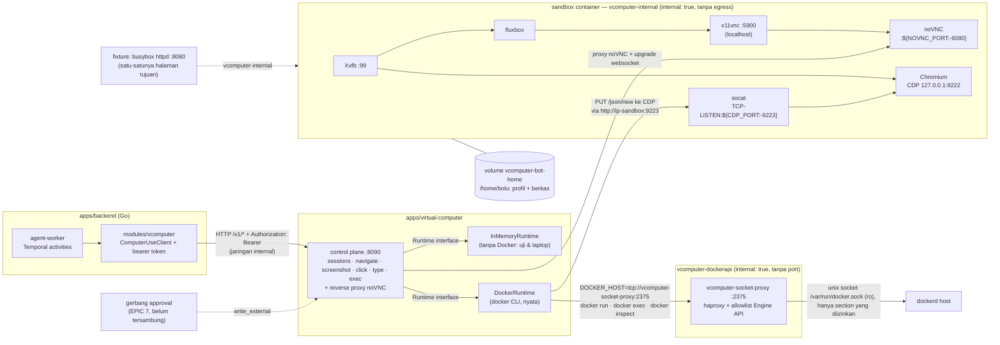

# Virtual Computer — PoC

Satu komputer per bot: layar desktop, browser, dan terminal di dalam satu container,
dikendalikan satu control plane kecil yang dipanggil worker Temporal.

**Ini PoC, bukan produksi.** Keputusannya ada di
[`docs/adr/0003-virtual-computer.md`](../../docs/adr/0003-virtual-computer.md); riset
lengkapnya di [`docs/riset-microvm.md`](../../docs/riset-microvm.md). Yang belum
dibangun dan sengaja tidak diklaim: isolasi untuk kode tak tepercaya (ini container
biasa), reaper idle, snapshot, lease layar, dan gerbang persetujuan untuk aksi keluar.

## Arsitektur



Delapan hal yang dibaca dari diagram itu:

1. **Backend tidak memanggil Docker.** Ia memanggil satu API HTTP di jaringan internal,
   dengan `Authorization: Bearer`. Control plane boleh berganti cara ia membuat sandbox
   (Docker hari ini, gVisor/K8s kelak) tanpa worker berubah.
2. **Socket Docker tidak ada di container control plane.** CLI docker di dalam
   `vcomputer-control` diarahkan `DOCKER_HOST=tcp://vcomputer-socket-proxy:2375`, dan
   `vcomputer-socket-proxy` satu-satunya container yang memegang `/var/run/docker.sock`
   (read-only). Proxy itu menjawab `403` untuk setiap section Engine API yang tidak
   dipakai runtime, dan tidak punya port yang dipublikasikan: satu-satunya jalan masuk
   adalah jaringan `vcomputer-dockerapi`, yang hanya memuat proxy dan control plane.
3. **Sandbox adalah proses yang bisa dibaca daftarnya**, bukan satu "komputer" opaque:
   Xvfb → fluxbox → x11vnc → noVNC, plus Chromium dengan CDP.
4. **State yang bertahan ada di volume**, bukan di proses: profil browser dan berkas
   hidup di `/home/bolu`, jadi container boleh mati dan sesi tidak hilang. Workflow
   hanya membawa pengenal — aturan *claim check* di ADR 0001.
5. **CDP hanya mendengarkan di loopback Chromium.** `--remote-debugging-address=0.0.0.0`
   diabaikan Chromium baru, jadi `socat TCP-LISTEN:${CDP_PORT},fork,reuseaddr,bind=0.0.0.0`
   yang mempublikasikannya ke alamat container. Control plane menyapa
   `http://<ip-sandbox>:9223` — **IP, bukan nama host** — karena endpoint DevTools menolak
   Host header yang bukan IP atau `localhost`.
6. **noVNC di-proxy.** Browser hanya perlu menjangkau control plane: path
   `/v1/sessions/<bot>/novnc/...` di-strip lalu diteruskan ke
   `http://<ip-sandbox>:<port-novnc>/` berikut upgrade websocket-nya. Tidak ada port
   sandbox yang pernah dipublikasikan ke host.
7. **Gerbang approval belum tersambung** (garis putus-putus). `click`, `type`, dan
   `exec` adalah `write_external` menurut riset §5.1; PoC men-stub jalur itu dan
   menyatakannya, bukan menganggapnya selesai.
8. **Proxy socket adalah pagar, bukan isolasi.** Ia mempersempit apa yang bisa dilakukan
   control plane yang diambil alih, tetapi `CONTAINERS` tetap ada di allowlist — jadi
   sandbox dengan HostConfig sembarang masih mungkin. Rinciannya di trade-off di bawah.

## Isi direktori

| Path | Apa itu |
| --- | --- |
| `control/` | Control plane (modul Go sendiri, tanpa dependensi selain stdlib) |
| `control/internal/sandbox/` | Port `Runtime` + `InMemoryRuntime` (tanpa Docker) + `DockerRuntime` (nyata, lewat CLI docker) |
| `control/internal/httpapi/` | Permukaan HTTP, autentikasi token, proxy noVNC, plus ujinya |
| `sandbox/` | Image sandbox: `Dockerfile` + `entrypoint.sh` |
| `fixture/` | Satu halaman statis yang disajikan `vcomputer-fixture` di jaringan internal |
| `demo/index.html` | Halaman statis yang menyematkan noVNC asli lewat proxy control plane |
| `docker-compose.poc.yml` | Stack PoC: `vcomputer-control` + `vcomputer-fixture` + `vcomputer-socket-proxy` + target build `vcomputer-sandbox`, dan tiga jaringan |
| `scripts/e2e.sh` | Checklist QA end-to-end: build, jalankan, periksa, tulis bukti, cetak PASS/FAIL |

## Permukaan API

| Method | Path | Body | Jawaban |
| --- | --- | --- | --- |
| `GET` | `/health` | — | `{"status":"ok","service":"vcomputer-control","poc":true}` — satu-satunya rute tanpa token |
| `POST` | `/v1/sessions` | `{"bot_id":"..."}` | `Session` (idempoten) |
| `GET` | `/v1/sessions/:bot_id` | — | `Session`, `404` bila belum ada |
| `DELETE` | `/v1/sessions/:bot_id` | — | `{"stopped":true}` |
| `POST` | `/v1/sessions/:bot_id/screenshot` | — | `image/png` (juga `GET`, untuk ``) |
| `POST` | `/v1/sessions/:bot_id/click` | `{"x":0,"y":0}` | `{"clicked":true}` |
| `POST` | `/v1/sessions/:bot_id/type` | `{"text":"..."}` | `{"typed":true}` |
| `POST` | `/v1/sessions/:bot_id/navigate` | `{"url":"http://..."}` | `200`; `400` bila skemanya bukan `http`, `https`, `data`, atau `about` |
| `POST` | `/v1/sessions/:bot_id/exec` | `{"command":"..."}` | `ExecResult` — perintahnya benar-benar dijalankan (`stub:false`) di runtime docker |
| `ANY` | `/v1/sessions/:bot_id/novnc/...` | — | `httputil.ReverseProxy` ke `http://<ip-sandbox>:<port-novnc>/` dengan prefix `/v1/sessions/:bot_id/novnc` dibuang; upgrade websocket didukung |

**Setiap rute `/v1/*` butuh token.** `Authorization: Bearer <VCOMPUTER_CONTROL_TOKEN>`,
dibandingkan constant-time; tanpa itu jawabannya `401 {"error":"unauthorized"}`. Control
plane menolak start bila `VCOMPUTER_CONTROL_TOKEN` kosong, dan `/health` satu-satunya yang
terbuka. Browser tidak bisa memasang header pada page load atau handshake websocket, jadi
URL noVNC boleh membawa `?token=<t>` satu kali: token itu menukar dirinya dengan cookie
`vc_token` (`HttpOnly`, `SameSite=Strict`, `Path=/v1/sessions/`), dan cookie itu diterima
seperti bearer biasa setelahnya.

Status yang membawa arti: `400` input ditolak, `401` token tidak ada atau salah, `404`
sesi tidak ada, `500`/`502` runtime gagal. Setiap rute di atas dilayani kedua runtime.

## Environment

| Variabel | Default | Arti |
| --- | --- | --- |
| `VCOMPUTER_CONTROL_ADDR` | `:8090` | alamat listen di dalam container |
| `VCOMPUTER_RUNTIME` | `memory` (`docker` di compose) | `memory` (tanpa Docker sama sekali) atau `docker` (runtime nyata) |
| `VCOMPUTER_CONTROL_TOKEN` | — (**wajib**) | rahasia bersama untuk setiap rute `/v1/*` |
| `VCOMPUTER_CONTROL_PORT` | `8090` | port host control plane |
| `DOCKER_HOST` | — (diisi compose) | alamat daemon untuk CLI docker di dalam container control; compose menunjuknya ke `tcp://vcomputer-socket-proxy:2375`, dan container itu tidak punya `docker.sock` untuk jadi fallback |
| `VCOMPUTER_SANDBOX_IMAGE` | `vcomputer-sandbox:poc` | image yang dijalankan runtime per bot |
| `VCOMPUTER_SANDBOX_NETWORK` | `vcomputer-internal` | jaringan Docker tempat sandbox bergabung |
| `VCOMPUTER_SANDBOX_NOVNC_PORT` | `6080` | port noVNC tiap sandbox, dikirim sebagai `-e NOVNC_PORT=` |
| `VCOMPUTER_SANDBOX_CDP_PORT` | `9223` | port CDP tiap sandbox, dikirim sebagai `-e CDP_PORT=` |
| `VCOMPUTER_EXEC_TIMEOUT` | `30s` | batas waktu satu `exec` |
| `SCREEN_GEOMETRY` | `1280x800x24` | geometri Xvfb, dikirim sebagai `-e` |
| `VNC_PASSWORD` | kosong | password VNC opsional (control plane tidak pernah memasangnya) |

Port sandbox **tidak pernah** dipublikasikan ke host: `docker run` tidak memakai `-p`
sama sekali. Satu-satunya port yang menyeberang ke host adalah control plane, dan hanya di
loopback: `127.0.0.1:${VCOMPUTER_CONTROL_PORT:-8090}:8090`. noVNC dan CDP dijangkau dari
jaringan internal — browser lewat proxy control plane, worker lewat `cdp_url` di
`Session`.

## Menjalankan

```bash
# Uji permukaan HTTP control plane. Modul ini ada di dalam go.work, jadi perintahnya
# jalan apa adanya dari checkout.
cd apps/virtual-computer/control && go vet ./... && go test ./...

# Runtime memory saja: tanpa Docker, tanpa container (token tetap wajib).
cd apps/virtual-computer/control && VCOMPUTER_CONTROL_TOKEN=$(openssl rand -hex 16) go run . -runtime memory

# Seluruh stack PoC (butuh Docker).
export VCOMPUTER_CONTROL_TOKEN=$(openssl rand -hex 16)
docker compose -f apps/virtual-computer/docker-compose.poc.yml up -d vcomputer-control vcomputer-fixture vcomputer-socket-proxy
```

Lalu seluruh checklist QA dalam satu perintah:

```bash
# Build image, naikkan control + fixture, jalankan pemeriksaan, tulis bukti ke
# docs/poc-evidence/virtual-computer, cetak PASS/FAIL per pemeriksaan.
BUILD_NETWORK=host apps/virtual-computer/scripts/e2e.sh

# Stack sengaja dibiarkan hidup supaya bisa diperiksa tangan; TEARDOWN=1 menurunkannya.
TEARDOWN=1 apps/virtual-computer/scripts/e2e.sh
```

`scripts/e2e.sh` men-generate token sendiri (dan menghormati `VCOMPUTER_CONTROL_TOKEN`
yang sudah ada), memakai `${DOCKER:-docker}` sehingga `DOCKER="sudo docker"` bisa dipakai,
dan keluar non-nol bila ada satu pemeriksaan yang gagal. `BUILD_NETWORK=host` hanya perlu
bila daemon build tidak bisa mengambil paket apt lewat jembatan jaringannya.

### Trade-off yang diterima: proxy socket dengan allowlist per section

Control plane mengendarai daemon lewat CLI docker, dan CLI itu butuh alamat daemon. Yang
**tidak** dilakukan PoC ini: me-mount socket ke container control plane. Yang dilakukan:
satu container tambahan, `vcomputer-socket-proxy`
(`tecnativa/docker-socket-proxy:v0.5.0`, tag dipin), memegang
`/var/run/docker.sock` read-only dan meneruskan Engine API lewat haproxy di port `2375`
dengan allowlist per section. CLI di container control plane diarahkan ke sana lewat
`DOCKER_HOST`, dan proxy itu hanya ada di jaringan `vcomputer-dockerapi`
(`internal: true`) bersama control plane — tanpa port yang dipublikasikan.

Allowlist-nya adalah **apa yang benar-benar dipanggil `internal/sandbox/docker.go`**, bukan
seluruh API:

| Section | Nilai | Yang memakainya |
| --- | --- | --- |
| `VOLUMES` | `1` | `docker volume create` (volume home per bot) |
| `CONTAINERS` | `1` | `docker run`, `docker inspect`, `docker start`, `docker stop` |
| `EXEC` | `1` | `docker exec` untuk screenshot / click / type |
| `POST` | `1` | setiap panggilan di atas adalah POST — dan CLI melakukan `HEAD /_ping` sebelum apa pun; ini juga yang mematikan gerbang method di proxy (lihat di bawah) |
| `ALLOW_START` / `ALLOW_STOP` | `1` | `docker start` / `docker stop` (redundan selama `CONTAINERS=1`; ditulis eksplisit karena itu operasi yang benar-benar dipakai runtime) |
| `PING` | `1` | ping CLI saat start (dari situ versi API dinegosiasikan) |
| sisanya (`IMAGES`, `INFO`, `NETWORKS`, `SYSTEM`, `SWARM`, `SECRETS`, `PLUGINS`, `EVENTS`, `AUTH`, `BUILD`, `COMMIT`, `CONFIGS`, `DISTRIBUTION`, `GRPC`, `NODES`, `SERVICES`, `SESSION`, `TASKS`, `VERSION`) | `0` | tidak ada — dijawab `403` oleh proxy, daemon tidak pernah melihat request-nya |
| `ALLOW_RESTARTS` / `ALLOW_PAUSE` / `ALLOW_UNPAUSE` | `0` | bukan penolakan: selama `CONTAINERS=1`, `restart`/`kill`/`pause` tetap lolos lewat section `/containers` (lihat di bawah) |

Yang **tidak** dibeli proxy ini, dan ditulis di sini supaya tidak ketemu belakangan. Allowlist
itu per **section**, bukan per operasi:

- `CONTAINERS=1` membuka **seluruh** path di bawah `/containers` — termasuk `restart`, `kill`,
  `pause`, `attach`, dan `DELETE` (`docker rm`), plus `DELETE /volumes/<name>`. Nilai
  `ALLOW_RESTARTS=0` tidak menutupnya: haproxy memeriksa rule `ALLOW_*` sebelum rule section,
  jadi selama `CONTAINERS=1`, `restart`/`kill` tetap lolos lewat `/containers`.
- `POST=1` — yang wajib, karena setiap tulis adalah POST — mematikan gerbang method di rule
  pertama (`deny unless METH_GET || POST`). Konsekuensinya method tidak lagi jadi batas: `PUT`
  ke section yang diizinkan tetap diterima.
- Proxy tidak memeriksa body request. Jadi `POST /containers/create` dengan HostConfig apa pun
  tetap bisa: container privileged, atau host root yang di-bind-mount. Control plane yang
  diambil alih karena itu **masih bisa mencapai root host** lewat API yang memang diizinkan
  untuknya.

Yang benar-benar hilang dari permukaan: tarik image, swarm, secret, plugin, `system`, `info`,
dan setiap section lain yang tidak dipakai runtime. Ditambah dua pagar yang sudah ada — token
wajib (control plane menolak start tanpa itu) dan port host hanya di `127.0.0.1` — dan satu
yang baru: sandbox tidak punya rute ke proxy sama sekali (`vcomputer-internal` ≠
`vcomputer-dockerapi`), dan tidak ada `docker.sock` di container control plane.

Harga yang dibayar: `IMAGES=0` berarti runtime tidak bisa menarik image, jadi
`vcomputer-sandbox:poc` harus sudah dibangun di daemon itu (`--profile build build`, atau
`scripts/e2e.sh`). Proxy juga satu titik kegagalan: tanpa dia, control plane tidak bisa
memanggil daemon sama sekali — dan itu disengaja, karena fallback ke socket akan
mengembalikan persis lubang yang ditutup.

Jalur produksinya tetap **bukan** proxy: ia klien Docker API di node sandbox yang terpisah
dari node API — atau gVisor/Kubernetes di Fase 2 riset. Proxy ini yang membuat PoC hari ini
berhenti memegang socket host; ia tidak mengubah rekomendasi itu.

## Halaman demo

`apps/virtual-computer/demo/index.html` adalah halaman statis: buka langsung dari berkas,
tanpa build dan tanpa server. Isi `token`, `bot_id`, dan port control plane (default
`8090`), lalu tekan **Buka desktop**. Halaman menyetel `iframe.src` ke
`http://127.0.0.1:<port>/v1/sessions/<bot>/novnc/vnc.html?autoconnect=true&resize=scale&path=...`,
jadi yang muncul adalah noVNC asli lewat proxy control plane — desktop yang sesungguhnya,
bukan mock CSS.

Token muncul dua kali dengan sengaja: `token` di query mengotorisasi page load sekaligus
memasang cookie, dan token di dalam `path` mengotorisasi websocket-nya. Halaman ini dibuka
dari `file://`, jadi browser yang memblokir cookie pihak ketiga tidak akan mengirim cookie
itu dari dalam iframe — dan websocket gagal tanpa token di `path`. Nilai disusun lewat
`encodeURIComponent` dan dipasang sebagai atribut, tidak pernah lewat `innerHTML`.

## Agent worker wiring

Activity-nya sekarang terdaftar di `agent-worker`, bukan lagi kode yang belum dipakai.
`apps/backend/internal/modules/vcomputer/` berisi port, klien HTTP (yang mengirim bearer
token), dan activity-nya — termasuk `Navigate` — dan `internal/container/vcomputer.go` yang
menyambungkannya:

- `NewVComputerTasks(cfg, log)` membangun set activity. Alamat kosong berarti **tanpa klien**:
  setiap activity menjawab `domain.ErrNotConfigured`, bukan memanggil alamat yang tidak
  dimaksud. Satu baris `Info` dicatat saat start dan menyebut apakah control plane
  terkonfigurasi — token tidak pernah masuk log.
- `Container.openVComputer` memanggilnya saat assembly, dan tidak butuh database, Redis, atau
  klien Temporal: komputer bot tidak bergantung pada apa yang diingat deployment.
- `RegisterVComputerTasks(w, c)` dipanggil dari `RegisterAgentTasks` **sebelum** cabang
  `c.Tasks == nil`, jadi worker yang runtime tugasnya mati (database sedang dimigrasi) tetap
  bisa menjalankan sandbox. Queue-nya queue agent worker yang sama; tidak ada worker kedua.

Konfigurasinya lewat environment, semuanya opsional:

| Variabel | Default | Arti |
| --- | --- | --- |
| `VCOMPUTER_CONTROL_URL` | kosong | alamat **internal** control plane; kosong = tidak terkonfigurasi |
| `VCOMPUTER_CONTROL_TOKEN` | kosong | rahasia bersama; harus sama dengan `VCOMPUTER_CONTROL_TOKEN` milik control plane |
| `VCOMPUTER_CONTROL_TIMEOUT` | `30s` | batas satu panggilan; nilai yang tidak bisa di-parse menggagalkan startup |

Yang terdaftar adalah **`SmokeWorkflow`** (`internal/modules/vcomputer/workflow/smoke.go`), dan
hanya itu: `AgentTaskWorkflow` dan katalog tool belum menyentuh sandbox (ADR 0003). Satu run
menjalankan urutan yang akan dipakai tugas sungguhan — `EnsureSession` → `Navigate` → jeda 3
detik → `Screenshot` → `Click` → `Type` → jeda 1 detik → `Screenshot` → `Exec` — dengan
`StartToCloseTimeout` 90 detik untuk `EnsureSession` dan 30 detik untuk sisanya, serta
`MaximumAttempts: 3`. Hasilnya ukuran dua tangkapan (bukan byte PNG-nya), `cdp_url`, stdout
`exec`, dan flag stub.

Menjalankannya, dari checkout, dengan control plane yang hidup (lihat **Menjalankan**):

```bash
cd apps/backend
VCOMPUTER_CONTROL_URL=http://127.0.0.1:8090 \
VCOMPUTER_CONTROL_TOKEN=$VCOMPUTER_CONTROL_TOKEN \
  go run ./cmd/vcomputer-smoke -bot bot-1 -url https://example.com -out /tmp/vcomputer-smoke
```

`cmd/vcomputer-smoke` adalah alat development, bukan proses yang di-deploy: ia menaikkan
worker-nya sendiri di queue `vcomputer-smoke` (bukan queue agent), mendaftarkan set activity
lewat `container.RegisterVComputerTasks`, menjalankan satu workflow, mencetak hasilnya sebagai
JSON, lalu — bila `-out` diisi — meminta satu tangkapan terakhir lewat klien HTTP dan menulis
`after-temporal-final.png`. Flag lain: `-temporal` (`$TEMPORAL_HOST_PORT`, default
`127.0.0.1:7233`), `-namespace` (default `default`), `-queue`, `-click-x`, `-click-y`, `-text`.
Keluar non-nol pada kegagalan pertama.

Satu catatan yang belum diselesaikan: hasil `Screenshot` membawa byte PNG lewat
workflow, dan batas payload Temporal secara bawaan 2 MiB. Versi yang disambungkan
seharusnya menulis PNG ke object storage Jakarta dan mengembalikan kuncinya — aturan
*claim check* yang sudah berlaku untuk hal lain (ADR 0001).

## Yang di-stub, dan apa artinya

| Bagian | Keadaan PoC | Yang dibutuhkan untuk produksi |
| --- | --- | --- |
| `DockerRuntime` | **Nyata**: `docker volume create`, `docker run`, `docker exec`, `docker inspect`, `docker stop` lewat CLI, tanpa `-p`, dan tanpa `docker.sock` di container control plane (lewat `vcomputer-socket-proxy` dengan allowlist) | Klien Docker API di node sandbox, tanpa `docker.sock` di dalam container control |
| `exec` di runtime `memory` | Echo; perintah tidak pernah dijalankan — hanya runtime ini yang begitu, runtime `docker` menjalankannya sungguhan | Label `write_external` + gerbang approval, atau allowlist perintah `read`-only |
| Gerbang approval | Tidak tersambung | Draf untuk `click`/`type`/`exec`, dengan tangkapan layar sebagai konteks |
| Isolasi | Container runc yang dikeraskan (`cap_drop: ALL`, `no-new-privileges`, limit RAM/PID), jaringan internal tanpa egress | gVisor di Kubernetes (riset Fase 2) |
| Biaya saat idle | Tidak ada reaper | Idle timeout + snapshot, kuota per paket |
| Lease layar | Tidak ada (satu sandbox per bot, jadi belum perlu) | Lease Redis bila kelak satu sandbox per workspace |

## Bukti

- `go test ./...` di `control/` menutup siklus sesi, PNG yang benar-benar bisa didekode,
  lima aksi (termasuk `navigate`), autentikasi 401/200, proxy noVNC, dan pemetaan status ke
  error. Runtime docker diuji dengan CLI docker palsu (skrip di `t.TempDir`), jadi `go test`
  tidak butuh Docker.
- `go test ./internal/modules/vcomputer/...` di backend menutup kontrak klien terhadap
  control plane (body yang dikirim, bearer token, PNG yang lewat utuh, sentinel error).
- `go test ./internal/modules/vcomputer/... ./internal/container/` menutup workflow smoke
  dengan activity yang di-mock (urutan langkah, koordinat dan teks yang sampai, tiga kali
  percobaan lalu gagal) dan registrasinya di worker (nama workflow dan activity yang
  terdaftar tercetak oleh `TestAgentWorkerRegistrationInventory`).
- `scripts/e2e.sh` menjalankan jalur yang sebenarnya di Docker dan menulis buktinya ke
  `docs/poc-evidence/virtual-computer/`.
- `scripts/e2e.sh` juga memeriksa pagar socket itu sendiri: container control tidak
  me-mount `docker.sock`, proxy tidak mempublikasikan port, `vcomputer-dockerapi` benar
  `internal: true`, `GET /images/json` lewat proxy dijawab `403`, dan sandbox tidak punya
  rute ke proxy.
- Tabel allowlist di atas diukur, bukan dibaca dari dokumentasi: haproxy dari image
  `tecnativa/docker-socket-proxy:v0.5.0` dijalankan di atas daemon tiruan dengan env yang sama
  seperti compose, dan CLI docker sungguhan digerakkan lewat proxy itu. Semua panggilan
  runtime (`volume create`, `run -d`, `inspect`, `start`, `stop`, `exec`) selesai dengan exit
  0; `image ls`, `info`, `network ls`, `pull`, `version` dan `system df` dijawab `403`. Dari
  situ juga terlihat batasnya: `restart`, `kill`, `DELETE /containers/<id>`,
  `DELETE /volumes/<name>` dan `PUT /containers/create` ikut lolos (docs/adr/0003 §Revisi
  2026-10-16 (b)). Harness-nya tidak ikut masuk repo karena butuh `python3` sebagai daemon
  tiruan; yang tetap ada di repo adalah pemeriksaan `403` di `scripts/e2e.sh`.

Perintah yang menjalankannya, dan alasannya bukan bagian dari `make test`/`make lint`:
kedua target itu per modul produk, masing-masing dengan `.golangci.yml` dan
`scripts/coverage.sh` sendiri. Modul PoC ini belum punya keduanya, dan menaruhnya di
`make test` tanpa `make cover` akan setengah menyambung gerbang mutu — jadi ia tetap
modul terpisah dengan perintahnya sendiri sampai PoC ini lulus Gerbang 1.
